<div align="center">


# Re:Spec Alarm

혼자 깨는 알람에서, 함께 약속을 지키는 알람으로

[](https://github.com/orgs/403-forbidden-capstone/projects/1)
[](https://github.com/403-forbidden-capstone/respec-alarm-capstone/issues/new/choose)
[](https://github.com/403-forbidden-capstone/respec-alarm-capstone/milestones)
[](https://github.com/403-forbidden-capstone/respec-alarm-capstone/pulls)

<sub>2026-2 캡스톤디자인 · 포텐셜랩스 산학 협력 · 팀 403 Forbidden</sub>

</div>

<br />

레포 안에서 지키는 GitHub 규칙만 담았습니다. Git 사용법과 협업 가이드는 노션에 있습니다.

## 작업 흐름

이슈 하나가 보드 위에서 이렇게 움직입니다. 굵은 화살표는 자동, 가는 화살표는 직접 옮깁니다.

```mermaid
flowchart LR
    issue["이슈 작성"]:::start
    backlog("백로그"):::backlog
    week("이번 주"):::week
    doing("진행 중"):::doing
    review("리뷰"):::review
    done("완료"):::done

    issue ==>|보드 등록| backlog
    backlog -->|계획| week
    week ==>|브랜치 생성| doing
    doing ==>|PR 생성| review
    review ==>|Squash 머지| done

    classDef start fill:#ffffff,stroke:#1f2328,color:#1f2328
    classDef backlog fill:#f6f8fa,stroke:#8c959f,color:#1f2328
    classDef week fill:#ddf4ff,stroke:#54aeff,color:#1f2328
    classDef doing fill:#fff8c5,stroke:#d4a72c,color:#1f2328
    classDef review fill:#fbefff,stroke:#c297ff,color:#1f2328
    classDef done fill:#dafbe1,stroke:#4ac26b,color:#1f2328
```



## 이슈

[New Issue](https://github.com/403-forbidden-capstone/respec-alarm-capstone/issues/new/choose)에서 틀을 고릅니다. 틀마다 Type이 정해져 있고, 만들면 보드에 바로 올라갑니다.

| 틀 | Type | 쓰는 때 |
|---|---|---|
| 기능 요청 · 추가 · 개선 | Feature | 새 기능 · 새 화면, 기존 기능 개선 |
| 버그 이슈 | Bug | 의도와 다르게 동작할 때 |
| 디자인 요청 | Design | 피그마 · UI · 화면 흐름 |
| 작업 | Task | 설정 · 문서 · 리팩토링 |

이슈 틀에 적은 값은 보드의 같은 칸으로 들어갑니다.

| 이슈에서 | 보드에서 |
|---|---|
| 파트 | 파트, 라벨 `FE` `BE` `DESIGN` |
| 우선순위 · 크기 | 우선순위 · 크기 |
| 시작일 · 목표일 | 시작일 · 목표일 · 주차 |
| 오른쪽 Assignees | 담당자 |
| 오른쪽 Milestone | 마일스톤 |

> [!TIP]
> 시작일을 비워 두면 브랜치를 만든 날이, 담당자가 없으면 브랜치를 만든 사람이 자동으로 들어갑니다.

## 브랜치와 PR

```text
브랜치    {유형}/{이슈번호}-{파트}-{설명}     feat/12-FE-alarm-list
PR 제목   [파트] [유형] 작업 내용             [FE] [FEAT] 알람 목록 화면 구현
```

| 유형 | 파트 |
|---|---|
| `feat` `fix` `docs` `refactor` `chore` | `FE` `BE` `AI` `DATA` `DESIGN` `ALL`(공통) |

- 브랜치 이름의 이슈 번호로 보드가 움직입니다. 번호가 빠지면 자동으로 옮겨지지 않습니다.
- PR 본문에 `Closes #이슈번호`를 적습니다. 머지되면 이슈가 닫히고 보드는 완료로 갑니다.
- 머지는 Squash만 허용되어 PR 제목이 그대로 `main`의 커밋 한 줄이 됩니다.
- 승인 1명을 받고 리뷰 대화를 모두 해결한 뒤 작성자 본인이 머지합니다. 머지한 브랜치는 자동으로 지워집니다.
- 아직 리뷰받을 상태가 아니면 제목 앞에 `[WIP]`를 붙입니다.

## 리뷰

사람 리뷰 1명이 기본이고, Claude가 보조합니다. PR 댓글에 `@claude 리뷰해줘`라고 쓰면 `pr-review` 스킬로 검수한 결과를 댓글로 남깁니다. 멘션할 때만 실행됩니다.

## main 보호 규칙

> [!IMPORTANT]
> 무료 플랜의 private 레포는 GitHub가 보호 규칙을 지원하지 않아, 지금은 팀 약속으로 지킵니다.

<details>
<summary>규칙 내용과 적용 방법</summary>

<br />

| 규칙 | 내용 |
|---|---|
| PR 필수 | `main`에 직접 push하지 않음 |
| 승인 | 1명 이상, 새 커밋이 올라오면 기존 승인은 무효 |
| 리뷰 대화 | 모두 해결해야 머지 |
| 머지 방식 | Squash만 |
| 강제 push · 브랜치 삭제 | 금지 |

조직이 Team 플랜으로 바뀌거나 레포가 public이 되면 Settings → Rules → Rulesets → New ruleset → Import a ruleset에서 [`.github/rulesets/main.json`](.github/rulesets/main.json)을 올리면 바로 적용됩니다.

</details>

## 마일스톤

| 마일스톤 | 내용 |
|---|---|
| M0 세팅 | 레포 · 협업 규칙 · 개발 환경 |
| M1 목업 화면 | 피그마 화면을 목업 데이터로 구현 |
| M2 기능① | 약속 기반 개인 알람 |
| M3 기능② | 알람 공유 · 기상 확인 |
| M4 기능③ | 수면 전후 Voice AI 대화 |
| M5 기능④ | 캘린더 · 하루 기록 |
| M6 기능⑥ | AI 대화형 일기 · 루틴 |
| 창의경진대회 데모 | 12/4 시연 |

<details>
<summary>관리자 설정</summary>

<br />

| Secret | 용도 |
|---|---|
| `PROJECT_TOKEN` | 보드 자동 연동 — `repo` · `project` 권한 토큰 |
| `CLAUDE_CODE_OAUTH_TOKEN` | Claude 리뷰 — `claude setup-token`으로 발급 |

자동화 파일: `.github/workflows/project-sync.yml`(보드 연동) · `.github/workflows/claude.yml`(Claude 리뷰)

</details>
